
<a href="https://www.linkedin.com/in/omar-albarghouthi"><picture><source media="(prefers-color-scheme: dark)" srcset="assets/bento/name-dark.svg">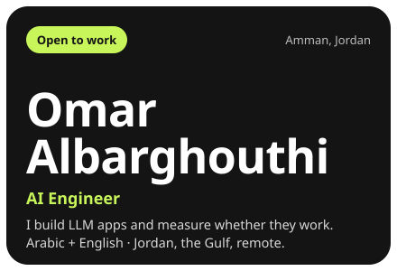</picture></a><a href="https://nice-table.vercel.app"><picture><source media="(prefers-color-scheme: dark)" srcset="assets/bento/nicetable-dark.svg">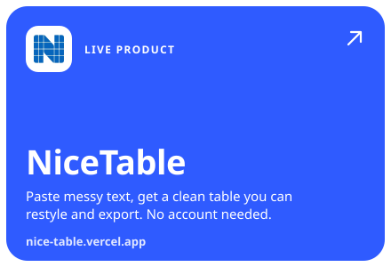</picture></a> 
<a href="https://github.com/ThisisOmar-here/CleanIQ"><picture><source media="(prefers-color-scheme: dark)" srcset="assets/bento/cleaniq-dark.svg">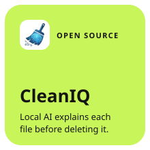</picture></a><a href="https://github.com/ThisisOmar-here/anatomy-of-llm-guardrails"><picture><source media="(prefers-color-scheme: dark)" srcset="assets/bento/guardrails-dark.svg">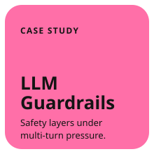</picture></a><a href="https://github.com/open-webui/open-webui/pull/32289"><picture><source media="(prefers-color-scheme: dark)" srcset="assets/bento/openwebui-dark.svg">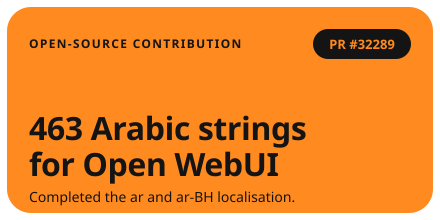</picture></a> 
<picture><source media="(prefers-color-scheme: dark)" srcset="assets/bento/visits-dark.svg">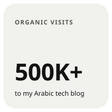</picture><a href="https://github.com/ThisisOmar-here"><picture><source media="(prefers-color-scheme: dark)" srcset="assets/bento/contributions-dark.svg">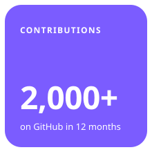</picture></a><a href="https://github.com/ThisisOmar-here/claude-usage-hack"><picture><source media="(prefers-color-scheme: dark)" srcset="assets/bento/usage-hack-dark.svg">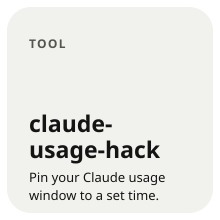</picture></a><picture><source media="(prefers-color-scheme: dark)" srcset="assets/bento/automation-dark.svg">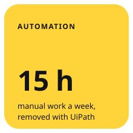</picture> 
<picture><source media="(prefers-color-scheme: dark)" srcset="assets/bento/toolbox-dark.svg">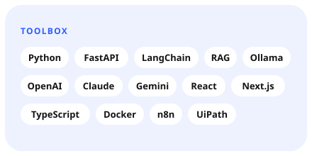</picture><a href="mailto:omarbarghouti505@gmail.com"><picture><source media="(prefers-color-scheme: dark)" srcset="assets/bento/email-dark.svg">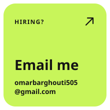</picture></a><a href="https://www.linkedin.com/in/omar-albarghouthi"><picture><source media="(prefers-color-scheme: dark)" srcset="assets/bento/linkedin-dark.svg">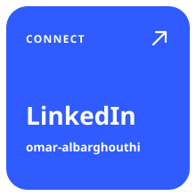</picture></a>

Software engineer (B.Sc. Software Engineering, Üsküdar University, 2026) building **LLM applications that real people use**, with a focus on evaluation: does the output parse, what does each turn cost, and how does the model behave when a user pushes it. Native Arabic speaker (Levantine and Gulf) working in English. Open to AI and software engineering roles in Jordan, the Gulf and remote.
