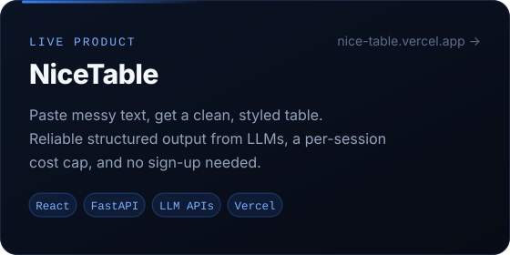
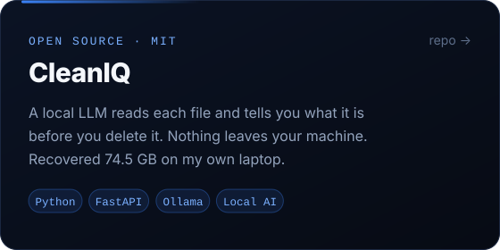
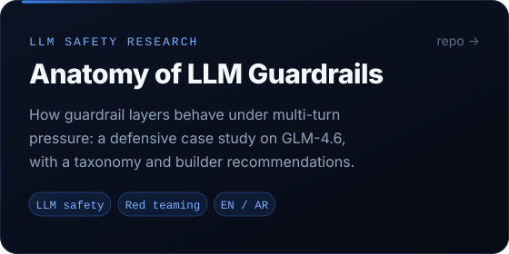
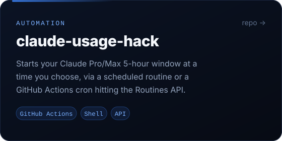
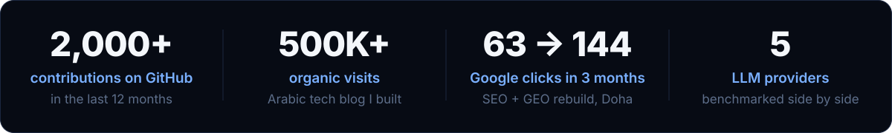
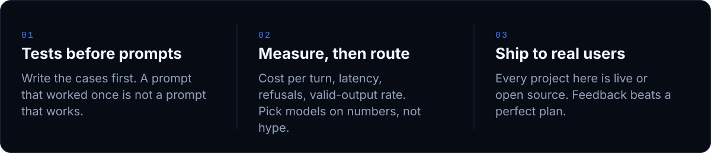
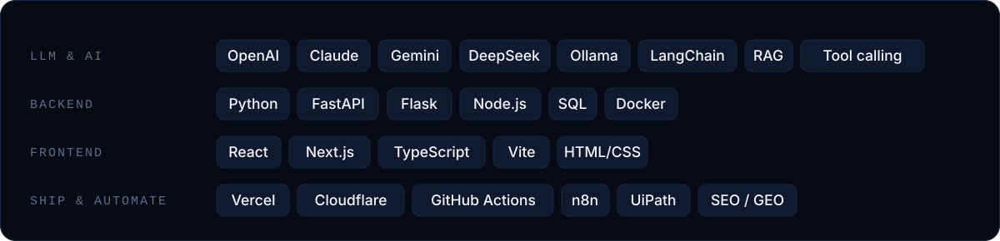

  

  
  
  

I'm a software engineer (B.Sc., Üsküdar University, 2026) who builds **LLM applications that real people use**, and I care most about the part that's easy to skip: **evaluation**. Does the output parse? What does each turn cost? What happens when a user pushes the model with a multi-turn attack? I write the tests first and pick models on the numbers.

Native Arabic speaker (Levantine and Gulf) working in English. Based in Amman, open to roles in **Jordan, the Gulf, and remote**.

  
  
  
  

<b>More work</b>

 

| Project | What it is |
|:--|:--|
| **Multi-model AI assistant** (graduation project) | Python + LangChain over GPT, Claude, Gemini, DeepSeek and Kimi, with tool and function calling. Benchmarked the models side by side on identical prompts for cost per turn, latency and refusals, then routed on the results. Entered in the OpenAI GPT-OSS Hackathon, Oct 2025. |
| [**snapback-cli**](https://github.com/ThisisOmar-here/snapback-cli) | A file-automation CLI: organise folders by type, bulk-rename by rule, find and remove duplicates. Preview-first; nothing changes without `--apply`. |
| **Aseel Constructions website** | Bilingual Arabic/English (RTL) site for a Doha contractor, built for Google *and* for LLM answers (GEO). More than doubled the site's Google clicks within three months. |
| **UiPath automations** (Xocialive internship) | 5+ RPA workflows for email and Excel processing that removed ~15 hours of manual work a week. |

- 🔬 **Building SFA-Bench**, a benchmark for *state-fabrication* attacks on LLM agents: what happens when a user feeds an agent fake "the safety check already passed" state, and a defence that separates trusted state from user text.
- 🌍 **Next: evaluating LLMs in Gulf Arabic**, how well today's models handle real dialect, not just Modern Standard Arabic.
- 📈 Going deeper on retrieval quality you can measure, and on what an agent loop actually costs per run.

---

  <b>Hiring for an AI or software engineering role?</b> 
  <a href="mailto:omarbarghouti505@gmail.com">omarbarghouti505@gmail.com</a> · <a href="https://www.linkedin.com/in/omar-albarghouthi">LinkedIn</a>

